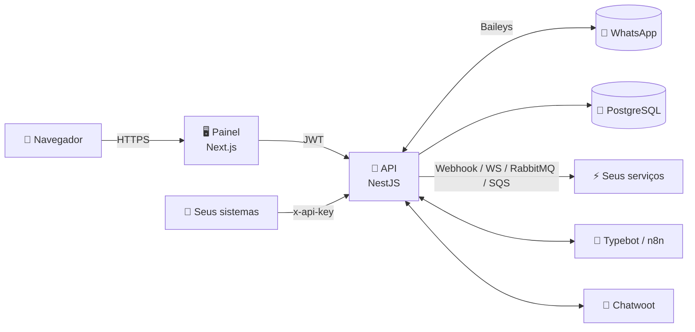

<div align="center">

<picture>
  <source media="(prefers-color-scheme: dark)" srcset="img/darkcerto.png">
  
</picture>

### API de WhatsApp open source, com painel whitelabel e integrações nativas

Conecte números de WhatsApp, envie mensagens por API REST, receba eventos em tempo real e integre com **Typebot**, **n8n** e **Chatwoot**, tudo no seu próprio servidor.

[](LICENSE)
[](https://nodejs.org)
[](#-instalação-com-docker)
[](https://nestjs.com)
[](https://nextjs.org)

[Instalação](#-instalação-com-docker) ·
[Primeiros passos](#-primeiros-passos) ·
[API](#-usando-a-api) ·
[Webhooks](#-eventos-e-webhooks) ·
[Integrações](#-integrações) ·
[Whitelabel](#-whitelabel) ·
[Problemas comuns](#-solução-de-problemas)

</div>

---

## ✨ Recursos

<table>
<tr>
<td width="50%" valign="top">

**📱 Multi-instância**
Vários números no mesmo servidor, cada um com sua API key. Conexão por QR Code, com link público de QR para o cliente escanear sozinho.

**💬 Mensagens completas**
Texto, imagem, áudio (convertido para nota de voz), vídeo, documento, contato, localização, enquete, **botões interativos** e **catálogo/produto** (WhatsApp Business).

**🛡️ Anti-banimento**
Fila por número com intervalo humano, variação aleatória, limite por minuto e "digitando..." antes de cada envio.

</td>
<td width="50%" valign="top">

**⚡ Eventos em tempo real**
Webhook (com assinatura HMAC), WebSocket, RabbitMQ e Amazon SQS, com mais de 25 tipos de evento.

**🤖 Integrações nativas**
Typebot e n8n (bots com gatilhos, debounce e pausa quando um atendente assume) e Chatwoot **bidirecional** (o agente responde e a mensagem chega no WhatsApp).

**🎨 Whitelabel**
Nome, logo, ícone, cor e textos por variável de ambiente, sem recompilar.

</td>
</tr>
</table>

---

## 🚀 Instalação com Docker

> **Requisitos:** servidor Linux com [Docker](https://docs.docker.com/engine/install/) e Docker Compose v2. Recomendado: 1 vCPU e 1 GB de RAM a cada ~10 números conectados.

```bash
# 1. Baixe o projeto
git clone https://github.com/usegoapi/progo.git goapi
cd goapi

# 2. Crie o arquivo de configuração
cp .env.example .env
```

Abra o `.env` e preencha **obrigatoriamente** os segredos (gere valores aleatórios):

```bash
# Gere cada valor com:  openssl rand -hex 32
POSTGRES_PASSWORD=...
JWT_SECRET=...
APP_SECRET=...

ADMIN_EMAIL=voce@suaempresa.com
ADMIN_PASSWORD=uma-senha-forte
```

```bash
# 3. Suba tudo (baixa as imagens prontas, sem compilar)
docker compose up -d

# 4. Acompanhe a inicialização
docker compose logs -f api
```

Pronto:

| Serviço | Endereço |
|---|---|
| 🖥️ Painel | `http://SEU_SERVIDOR:3010` |
| 🔌 API | `http://SEU_SERVIDOR:4000` |
| ❤️ Saúde | `http://SEU_SERVIDOR:4000/health` |

> 💡 Se `ADMIN_PASSWORD` ficar vazio, uma senha aleatória é gerada e aparece **uma única vez** no log da API (`docker compose logs api`).

### Imagens Docker

As imagens são publicadas automaticamente a cada versão, para **amd64** e **arm64**, com SBOM e atestado de origem:

| Imagem | Pull |
|---|---|
| [API](https://github.com/usegoapi/progo/pkgs/container/goapi-api) | `docker pull ghcr.io/usegoapi/goapi-api:latest` |
| [Painel](https://github.com/usegoapi/progo/pkgs/container/goapi-panel) | `docker pull ghcr.io/usegoapi/goapi-panel:latest` |

Para fixar uma versão, defina `GOAPI_VERSION` no `.env` (ex: `2.0.0`). Para compilar a partir do código:

```bash
docker compose -f docker-compose.yml -f docker-compose.build.yml up -d --build
```

### Colocando em produção (domínio + HTTPS)

Use um proxy reverso (Nginx, Caddy, Traefik, Easypanel, Coolify...) apontando dois domínios para os containers:

| Domínio | Destino |
|---|---|
| `painel.suaempresa.com` | porta `3010` |
| `api.suaempresa.com` | porta `4000` (habilite **WebSocket** se for usar `/ws`) |

E ajuste no `.env`:

```bash
PUBLIC_API_URL=https://api.suaempresa.com        # usado pelo navegador e pelo Chatwoot
CORS_ORIGINS=https://painel.suaempresa.com       # restringe quem chama a API pelo navegador
BLOCK_PRIVATE_NETWORK=true                       # recomendado se outras pessoas usarem o painel
```

<details>
<summary><b>Exemplo com Caddy (HTTPS automático)</b></summary>

```caddy
painel.suaempresa.com {
    reverse_proxy localhost:3010
}

api.suaempresa.com {
    reverse_proxy localhost:4000
}
```
</details>

### Atualizando

```bash
git pull
docker compose pull
docker compose up -d
```

O schema do banco é sincronizado automaticamente na inicialização. As sessões do WhatsApp ficam no volume `sessions` e **não se perdem** em atualizações.

---

## 🧭 Primeiros passos

1. **Entre no painel** com o `ADMIN_EMAIL` e o `ADMIN_PASSWORD` do `.env`.
2. Em **Instâncias**, clique em **Nova instância** e dê um nome.
3. Clique em **Conectar** e escaneie o QR Code no celular:
   *WhatsApp › Menu (⋮) › Aparelhos conectados › Conectar aparelho.*
   Também é possível **compartilhar um link** do QR para outra pessoa escanear.
4. Copie a **API key** exibida no card da instância.
5. Em **Testar API**, envie uma mensagem de teste e veja a prévia antes de disparar.

> 🔑 Troque sua senha a qualquer momento pelo ícone de chave no menu lateral. Isso encerra todas as outras sessões abertas.

---

## 🔌 Usando a API

Todas as rotas de envio usam a **API key da instância** no header `x-api-key`. A instância é identificada pela chave, nunca pelo corpo da requisição.

```bash
curl -X POST https://api.suaempresa.com/api/send/text \
  -H "Content-Type: application/json" \
  -H "x-api-key: goapikey_SUA_CHAVE" \
  -d '{ "to": "5511999999999", "text": "Olá! 👋" }'
```

### Rotas de envio

| Método | Rota | Descrição |
|---|---|---|
| `GET` | `/api/instance` | Status da instância e tamanho da fila |
| `POST` | `/api/check-numbers` | Verifica se números têm WhatsApp (até 50) |
| `POST` | `/api/send/text` | Texto (`*negrito*`, `_itálico_`, `~riscado~`) |
| `POST` | `/api/send/image` | Imagem por URL ou data URI base64 |
| `POST` | `/api/send/audio` | Áudio, convertido para nota de voz (`ptt: true`) |
| `POST` | `/api/send/video` | Vídeo |
| `POST` | `/api/send/document` | Documento (PDF, planilhas, etc.) |
| `POST` | `/api/send/contact` | Cartão de contato |
| `POST` | `/api/send/location` | Localização |
| `POST` | `/api/send/poll` | Enquete |
| `POST` | `/api/send/buttons` | Botões interativos |
| `POST` | `/api/send/catalog` | Cartão "Ver catálogo" (WhatsApp Business) |
| `POST` | `/api/send/product` | Produto do catálogo (WhatsApp Business) |

Todas aceitam o campo opcional `delay` (ms): tempo exibindo "digitando..." antes do envio.

<details>
<summary><b>📷 Imagem, áudio e documento</b></summary>

```json
POST /api/send/image
{ "to": "5511999999999", "imageUrl": "https://site.com/foto.jpg", "caption": "Legenda" }

POST /api/send/audio
{ "to": "5511999999999", "audioUrl": "https://site.com/audio.mp3", "ptt": true }

POST /api/send/document
{ "to": "5511999999999", "documentUrl": "https://site.com/contrato.pdf", "filename": "contrato.pdf" }
```
</details>

<details>
<summary><b>🔘 Botões interativos</b></summary>

Até 10 botões de 4 tipos: `reply` (resposta rápida), `url` (abre link), `call` (liga) e `copy` (copia um código, como cupom ou chave Pix).

```json
POST /api/send/buttons
{
  "to": "5511999999999",
  "title": "Atendimento",
  "text": "Como podemos ajudar?",
  "footer": "Escolha uma opção",
  "buttons": [
    { "type": "reply", "text": "Falar com vendas", "id": "vendas" },
    { "type": "url",   "text": "Acessar site",     "url": "https://suaempresa.com" },
    { "type": "call",  "text": "Ligar",            "phoneNumber": "5511999999999" },
    { "type": "copy",  "text": "Copiar cupom",     "copyCode": "CUPOM10" }
  ]
}
```

Quando o contato toca num botão `reply`, você recebe o evento `MESSAGES_UPSERT` com `buttonId: "vendas"`.
</details>

<details>
<summary><b>🛍️ Catálogo e produto (WhatsApp Business)</b></summary>

```json
POST /api/send/catalog
{ "to": "5511999999999", "text": "Confira nossas novidades", "buttonText": "Ver catálogo" }

POST /api/send/product
{
  "to": "5511999999999",
  "productId": "1234567890",
  "title": "Camiseta básica",
  "price": 59.9,
  "currency": "BRL",
  "imageUrl": "https://site.com/camiseta.jpg"
}
```

O `productId` é o número do link do produto (`wa.me/p/ID/telefone`), obtido em *Catálogo › produto › Compartilhar*.

> ⚠️ Atualmente o WhatsApp não responde a consultas de catálogo feitas por aparelhos conectados. Por isso o envio de produto recebe os dados (nome, preço e imagem) na própria requisição.
</details>

### Rotas de gestão (painel)

As rotas abaixo usam `Authorization: Bearer <JWT>`, obtido em `POST /auth/login`:

`/instances` · `/instances/:id/connect` · `/instances/:id/qr` · `/instances/:id/settings` · `/instances/:id/rotate-key` · `/webhooks` · `/integrations` · `/messages/*`

A referência completa, com exemplos prontos para copiar, está no menu **Documentação** do painel.

---

## ⚡ Eventos e webhooks

Configure por instância (*Instâncias › Configurações › Events*) ou de forma global (menu **Webhooks**).

| Evento | Quando acontece |
|---|---|
| `MESSAGES_UPSERT` | Mensagem recebida (ou enviada pelo celular) |
| `SEND_MESSAGE` | Mensagem enviada pela API, pelo painel ou por bots |
| `MESSAGES_UPDATE` | Entregue / lida |
| `CONNECTION_UPDATE` | Conectou, caiu ou reconectando |
| `QRCODE_UPDATED` | Novo QR Code (inclui imagem em base64) |
| `CALL` | Chamada recebida |
| `CONTACTS_*`, `CHATS_*`, `GROUPS_*`, `PRESENCE_UPDATE`… | Demais eventos |

**Formato da entrega:**

```json
{
  "event": "MESSAGES_UPSERT",
  "instance": { "id": "…", "name": "Atendimento" },
  "data": { "chatJid": "5511999999999@s.whatsapp.net", "text": "Oi!", "pushName": "Maria", "buttonId": null, "…": "…" },
  "date_time": "2026-01-01T12:00:00.000Z"
}
```

**Validando a assinatura** (quando o webhook tem um segredo configurado):

```js
const crypto = require('crypto');

const expected = crypto
  .createHmac('sha256', SEGREDO)
  .update(`${req.headers['x-timestamp']}.${rawBody}`)
  .digest('hex');

const valido = req.headers['x-signature'] === `sha256=${expected}`;
```

Falhas (erro 5xx ou timeout) são reenviadas até 3 vezes: após 2s, 10s e 30s.

<details>
<summary><b>WebSocket, RabbitMQ e SQS</b></summary>

- **WebSocket (Socket.IO):** conecte em `wss://api.suaempresa.com` com `path: "/ws"` e `auth: { apikey: "goapikey_..." }` (uma instância) ou `auth: { token: "<JWT>" }` (todas as suas instâncias).
- **RabbitMQ:** publica em um exchange `topic` (padrão `goapi`) com a routing key `<instancia>.<evento>`.
- **Amazon SQS:** envia para a fila configurada. Filas `.fifo` são suportadas.
</details>

---

## 🤖 Integrações

As integrações podem ser configuradas **por instância** (*Instâncias › Configurações*) ou **de forma global** (menu **Integrações**), valendo para todas as instâncias. A configuração da instância tem prioridade.

<details>
<summary><b>Typebot</b></summary>

1. Publique seu fluxo no Typebot e copie o **Public ID** (ex: `meu-bot-abc123`).
2. Informe a **URL** da sua instância Typebot (ex: `https://typebot.io`) e o Public ID.
3. Escolha o gatilho: palavra-chave (contém, igual, começa com, regex) ou todas as mensagens.

Botões de escolha do Typebot viram um menu numerado; o contato responde com o número. As variáveis `remoteJid`, `phoneNumber`, `pushName` e `instanceName` são preenchidas automaticamente.
</details>

<details>
<summary><b>n8n</b></summary>

1. Crie um workflow com um nó **Webhook** (POST) e copie a URL de produção.
2. Cole a URL na integração (com Basic Auth, se usar).
3. O workflow recebe `{ message, remoteJid, phoneNumber, pushName, buttonId, instanceName, sessionId, … }`.
4. A resposta do workflow é enviada ao contato. Formatos aceitos: texto puro, `{ "output": "..." }` (AI Agent), `{ "message": "..." }`, `{ "messages": ["...", "..."] }` ou `{ "mediaUrl": "...", "mediaType": "image" }`. Retorne `{ "endSession": true }` para encerrar a conversa.
</details>

<details>
<summary><b>Chatwoot (bidirecional)</b></summary>

1. No Chatwoot, gere um **Access Token** (*Perfil › Access Token*) e anote o **Account ID**.
2. Informe a URL, o Account ID e o token na integração. A conexão é validada ao salvar.
3. Uma inbox do tipo **API** é criada automaticamente, já com o webhook de retorno configurado.

Mensagens do WhatsApp (inclusive mídia) aparecem no Chatwoot, e as respostas dos agentes chegam ao WhatsApp.

> ⚠️ O Chatwoot precisa alcançar a API pela `PUBLIC_API_URL` para que as respostas cheguem ao WhatsApp.
</details>

**Comportamento dos bots:**

- Quando um atendente responde pelo celular, o bot pausa naquela conversa (*stopBotFromMe*).
- Mensagens antigas ou recebidas com o aparelho offline **não** disparam bots.
- A mensagem de "não entendi" só é enviada dentro de uma conversa ativa, nunca para todos os contatos.

---

## 🎨 Whitelabel

Configure no `.env` e reinicie o painel (`docker compose up -d`). Não é preciso recompilar:

| Variável | Exemplo | Efeito |
|---|---|---|
| `BRAND_NAME` | `Acme Zap` | Nome no painel, títulos e em "Aparelhos conectados" do WhatsApp |
| `BRAND_LOGO_URL` | `https://cdn.acme.com/logo.png` | Logo do painel e do login |
| `BRAND_ICON_URL` | `https://cdn.acme.com/icon.png` | Favicon |
| `BRAND_PRIMARY_COLOR` | `#2563eb` | Cor principal (o contraste do texto é calculado automaticamente) |
| `BRAND_TAGLINE` | `Atendimento inteligente` | Texto da tela de login |
| `BRAND_SUPPORT_URL` | `https://wa.me/55...` | Link do menu "Suporte" (oculto se vazio) |
| `BRAND_COPYRIGHT` | `© Acme LTDA` | Rodapé |

---

## 🛡️ Anti-banimento

Todo envio (API, painel, bots e Chatwoot) passa por uma fila por número:

| Variável | Padrão | O que faz |
|---|---|---|
| `SEND_MIN_INTERVAL_MS` | `900` | Intervalo mínimo entre mensagens |
| `SEND_JITTER_MS` | `600` | Variação aleatória somada ao intervalo |
| `SEND_MAX_PER_MINUTE` | `40` | Limite de mensagens por minuto, por número |
| `TYPING_SIMULATION` | `true` | Mostra "digitando..." / "gravando..." antes de enviar |

A reconexão automática usa espera crescente e **não insiste** quando o WhatsApp encerra a sessão, bloqueia o número (403) ou a sessão é aberta em outro lugar (440).

> ⚠️ Nenhuma ferramenta elimina o risco de banimento. Evite disparos em massa para quem não pediu para receber mensagens.

---

## 🔒 Segurança

- Senhas com bcrypt. O JWT é revogado ao trocar a senha. Há rate limit no login e nas rotas públicas.
- Cada usuário só acessa as **próprias** instâncias. O cadastro público vem **desligado** (`ALLOW_REGISTRATION=false`).
- Erros internos nunca expõem stack trace ou SQL. Os logs mascaram telefones e não exibem chaves de criptografia.
- Links públicos de QR Code são guardados apenas como hash e expiram.
- `BLOCK_PRIVATE_NETWORK=true` impede que webhooks e integrações apontem para a rede interna (proteção contra SSRF).
- Containers rodam sem root. O PostgreSQL não é exposto fora da rede interna do Docker.

Encontrou uma vulnerabilidade? Veja [SECURITY.md](SECURITY.md).

---

## 🏗️ Arquitetura



```
api/        Backend NestJS (instâncias, fila de envio, eventos, integrações)
frontend/   Painel Next.js whitelabel
baileys/    Biblioteca de WhatsApp (pré-compilada)
```

---

## 🧑‍💻 Desenvolvimento local

Requisitos: Node.js 22+ e PostgreSQL.

```bash
# API
cd api
cp .env.example .env            # ajuste DATABASE_URL e JWT_SECRET
npm install
npx prisma db push
npm run start:dev               # http://localhost:3001

# Painel (em outro terminal)
cd frontend
cp .env.example .env            # API_URL=http://localhost:3001
npm install
npm run dev                     # http://localhost:3000
```

---

## 🩺 Solução de problemas

<details>
<summary><b>O QR Code expira e para de aparecer</b></summary>

Por segurança, a conexão é pausada após 6 QR Codes sem leitura. Clique em **Conectar** novamente quando estiver com o celular em mãos.
</details>

<details>
<summary><b>"Sessão aberta em outro local" / a instância desconecta sozinha</b></summary>

O mesmo número foi conectado em outro sistema ou servidor. O WhatsApp só permite uma sessão por aparelho vinculado. Desconecte o outro e reconecte aqui.
</details>

<details>
<summary><b>Catálogo: "O WhatsApp não respondeu à consulta do catálogo"</b></summary>

É uma limitação atual do WhatsApp para aparelhos conectados, não um erro da API. O cartão **"Ver catálogo"** continua funcionando normalmente. Para enviar um **produto**, informe nome, preço e imagem na requisição.
</details>

<details>
<summary><b>As respostas do Chatwoot não chegam ao WhatsApp</b></summary>

Confira se a `PUBLIC_API_URL` está acessível a partir do servidor do Chatwoot (de preferência um domínio com HTTPS, não `localhost`).
</details>

<details>
<summary><b>Docker no Windows: "failed to connect to the docker API"</b></summary>

Ative a virtualização (Intel VT-x / AMD-V) na BIOS e o WSL2 no Windows. Sem isso, o motor do Docker Desktop não inicia.
</details>

---

## 🤝 Contribuindo

Contribuições são bem-vindas! Leia o [CONTRIBUTING.md](CONTRIBUTING.md) para saber como rodar o projeto, o padrão de código e como abrir um Pull Request.

## ⚖️ Aviso legal

Este projeto **não é afiliado, associado nem endossado pelo WhatsApp ou pela Meta**. "WhatsApp" é marca registrada de seus respectivos donos. Use de forma responsável e de acordo com os [Termos de Serviço do WhatsApp](https://www.whatsapp.com/legal/terms-of-service). Os autores não se responsabilizam por bloqueios de números ou pelo uso indevido da ferramenta.

## 📄 Licença

Distribuído sob a licença [MIT](LICENSE). Você pode usar, modificar e distribuir livremente, inclusive para fins comerciais.

<div align="center">
<br>
Feito com 💛 pela comunidade GO-API
</div>
